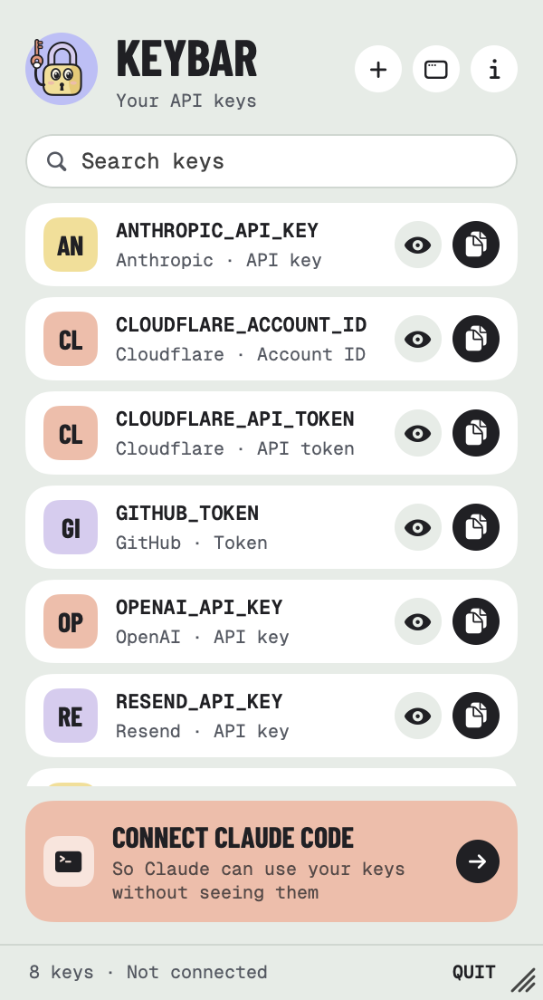
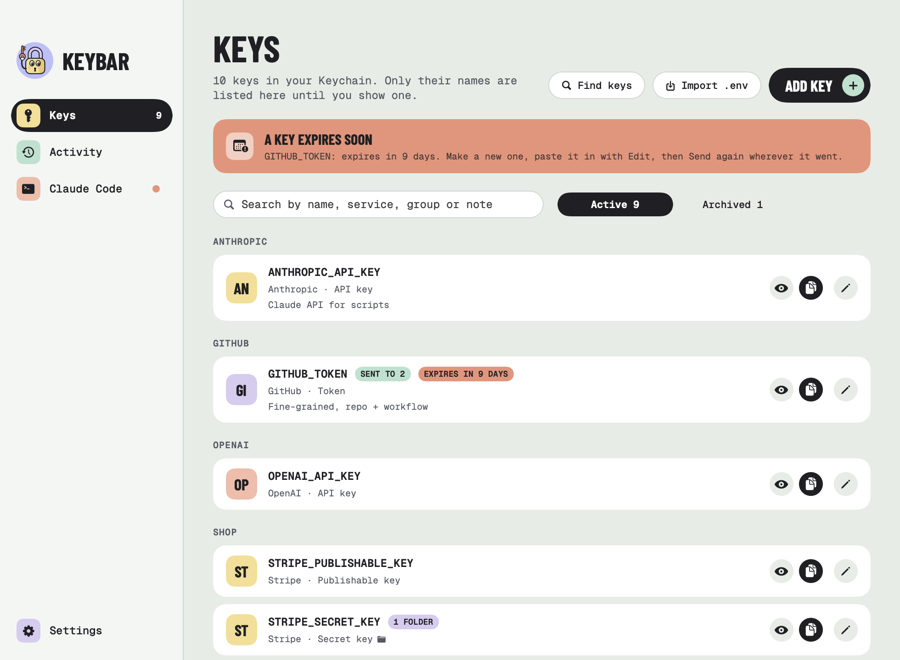

<p align="center">
  
</p>

<h1 align="center">KeyBar</h1>

<p align="center">
  <strong>Your API keys in the Keychain, ready for Claude Code without it ever seeing them.</strong><br>
  A free, open-source Mac menu bar app. Store a key once (Claude, Cloudflare, GitHub, Stripe, anything) and Claude Code uses it through KeyBar's MCP server: the key goes into one command as an environment variable, and any copy of it in the output is replaced with <code>[REDACTED]</code> before Claude sees it.
</p>

<p align="center">
  <a href="https://github.com/RossNicholson/keybar/releases/latest"></a>
  
  
  
  <a href="LICENSE"></a>
</p>

<p align="center">
  <picture>
    <source media="(prefers-color-scheme: dark)" srcset="docs/screenshot-dark.png">
    
  </picture>
</p>

<p align="center">
  <a href="#install">Install</a> ·
  <a href="#connect-claude-code">Connect Claude Code</a> ·
  <a href="#features">Features</a> ·
  <a href="#security">Security</a> ·
  <a href="#privacy">Privacy</a> ·
  <a href="#build-from-source">Build</a>
</p>

---

## Install

```bash
brew tap RossNicholson/tap
brew trust --cask rossnicholson/tap/keybar
brew install --cask keybar
```

Homebrew 7 asks you to trust casks from other taps before installing them. On older versions of Homebrew, skip the `brew trust` line. The cask also puts the `keybar` command on your PATH.

**Requirements:** macOS 14 Sonoma or later, on Apple silicon or Intel.

### Updating

**Settings → Check for updates → Update KeyBar** quits, updates and reopens it. Or run `brew upgrade --cask keybar`. Installed from the DMG instead, Check for updates opens the latest release's page. Claude Code sessions that were open during an update keep working: their helper notices it's out of date and passes requests through the new one. (Sessions started before 1.4.2 need reconnecting once, with `/mcp`.)

## Connect Claude Code

Open KeyBar, go to **Claude Code** and click **Connect Claude Code**. That adds KeyBar's MCP server to Claude Code for all your projects (user scope), using `claude mcp add` when it can find the `claude` command and editing `~/.claude.json` when it can't. If you leave the option on, it also adds a short marked note to `~/.claude/CLAUDE.md` telling Claude to check KeyBar before asking you for a key. **Disconnect** removes both.

New Claude Code sessions pick it up. Then just ask: *"deploy the site with my Cloudflare token"*. Claude lists the keys, runs `wrangler` with `$CLOUDFLARE_API_TOKEN` set, and never sees the token.

To connect by hand:

```bash
claude mcp add --scope user keybar -- /Applications/KeyBar.app/Contents/Helpers/keybar mcp
```

### The tools

| Tool | What it does |
|---|---|
| `list_secrets` | The stored keys' names, services and kinds (e.g. `CLOUDFLARE_API_TOKEN: Cloudflare API token`), and which are files or expire soon. Never values. |
| `run_with_secrets` | Runs a shell command with the named keys set as environment variables. Returns the exit code, stdout and stderr, with every copy of a key replaced by `[REDACTED]`. |
| `request_secret` | Asks you for a key KeyBar doesn't have. KeyBar opens *Add key* with the name filled in and Claude's reason (what it's for, where to make one) above it. You paste the key; Claude only hears that it's stored. |
| `send_secret` | Sends a stored key to a GitHub repo's Actions secrets, or a Cloudflare Worker or Pages project, so a deploy can use it. Always asks with Touch ID, whatever *Ask before Claude uses a key* is set to. |

### Other AI apps

The same screen connects **Claude Desktop, Cursor, Windsurf, VS Code (Copilot agent mode), Codex CLI and Gemini CLI**: **Connect** adds KeyBar's server to that app's own MCP settings file and keeps everything else in it. A settings file with comments (which isn't plain JSON) is left alone, and **Setup** shows the lines to add by hand. Zed is always set up by hand. The activity log names the app that used each key.

| App | Settings file |
|---|---|
| Claude Desktop | `~/Library/Application Support/Claude/claude_desktop_config.json` |
| Cursor | `~/.cursor/mcp.json` |
| Windsurf | `~/.codeium/windsurf/mcp_config.json` |
| VS Code | `~/Library/Application Support/Code/User/mcp.json` |
| Codex CLI | `~/.codex/config.toml` (a block between `# KeyBar:start` and `# KeyBar:end`) |
| Gemini CLI | `~/.gemini/settings.json` |
| Zed | `~/.config/zed/settings.json` (by hand) |

## Project key lists: `.keybar`

Put a `.keybar` file in a project's folder listing the keys it uses, one name per line (**Dev tools → Make one…** writes it for you). Inside that folder, and the folders under it:

- Claude's `list_secrets` only shows those keys, and `run_with_secrets` refuses any other.
- `keybar run -- COMMAND` sets them, with no `--key` flags or `.env` needed.

```
# The keys this project uses
CLOUDFLARE_API_TOKEN
CLOUDFLARE_ACCOUNT_ID
```

It holds names only, never values, so it's safe to commit. KeyBar looks for the nearest `.keybar` going up from the folder, stopping at your home folder.

## Find keys on this Mac

Already have keys in `.env` files? **Keys → Find keys** looks through the folders you choose for `.env` files (and `.mcp.json`), plus `export` lines in `~/.zshrc` and friends, the env of MCP servers in `~/.claude.json`, `~/.aws/credentials` and `~/.npmrc`. It skips `node_modules`, builds, hidden folders and example files, and only lists things that look like keys.

You tick what to import. The same value found in several projects becomes one key. When two projects use one name for different values, each gets its project's name in front (`SHOP_STRIPE_SECRET_KEY`, `BLOG_STRIPE_SECRET_KEY`), and you can rename them. Values KeyBar already has are marked as such.

Then, if you like, KeyBar takes the keys out of your `.env` files: each value becomes a reference to where it's stored, and other lines stay as they are.

```bash
STRIPE_SECRET_KEY=keybar:SHOP_STRIPE_SECRET_KEY
PORT=3000
```

## Run your own commands with keys: `keybar run`

```bash
keybar run -- npm run dev                                # keys from ./.env's keybar: lines
keybar run --key CLOUDFLARE_API_TOKEN -- wrangler deploy  # or name them
keybar run --key TOKEN=SHOP_API_TOKEN -- ./deploy.sh      # set a key under another name
keybar run --env-file .env.production -- npm start
```

KeyBar asks with Touch ID first and shows the command. It asks every time you run it, whatever Settings says about Claude, because its output isn't redacted: a yes is never reused, so nothing can slip a different command in under an earlier approval. Other lines in the `.env` are set too, unless they're set already, the way dotenv does it, so tools that read `.env` themselves (Next.js, Vite, dotenv) keep working: the real values are already in the environment. Folder limits apply, and inside Claude Code `keybar run` refuses and points Claude to `run_with_secrets`.

## The AI proxy: keys commands never have

For **Anthropic, OpenAI and Groq API keys**. Edit a key and turn on **Through KeyBar's proxy**. From then on, a command given that key gets the placeholder `keybar-proxy` instead of the value, plus a local address in `ANTHROPIC_BASE_URL` (or `OPENAI_BASE_URL`, `GROQ_BASE_URL`). The official SDKs and most tools read those, so they send their requests to KeyBar, which swaps in the real key and passes the request on to the service over HTTPS. Streaming replies come straight back.

The command never has the key, so nothing it prints, logs or sends anywhere can contain it. Each address is a one-off: it only works while that command runs, and only on `127.0.0.1`. The activity log counts the requests that went through. A command that calls the service's own address directly (`curl https://api.anthropic.com/…`) only has the placeholder and fails, which is why it's off until you turn it on.

## Leak check

**Leak check** looks for the exact values of your stored keys where they've been copied:

- Claude Code's transcripts, prompt history and settings (`~/.claude`, `~/.claude.json`)
- Codex, Gemini CLI, Cursor, Windsurf and Claude Desktop's chats and settings
- zsh, bash and fish history, and Python, Node and database console history
- With **Include git history** on, every commit in the repositories under your *Find keys* folders

A find means there's a copy of the key in a plain-text file outside the Keychain, not that anyone has used it. Each one says who could have seen that copy: a chat or prompt history was most likely sent to that AI service with the conversation; a settings file or shell history stays on your Mac (but any app you run, and your backups, have it); git history is with anyone who has the repo. Each find shows the file (or the commit and file), how many copies, and **Show** in Finder. **Hide** replaces the copies in that file with `[REDACTED]`; a key in git history can't be hidden. Either way the safe fix is a new key, so each leaked key has **Rotate**. Account IDs, publishable keys and other identifiers aren't secret and are skipped, and so are values under 12 characters. It all runs on your Mac.

## Commit guard

**Dev tools → Stop commits that contain a key** checks every commit in every repo on this Mac, whoever makes it, you or Claude. Before the commit, `keybar guard` reads the staged changes and asks KeyBar whether any added line holds a stored key's value; KeyBar answers with key names only, so the hook never sees a value. A commit with a key is stopped and the file named:

```
KeyBar stopped this commit: it contains the value of a stored key.
  src/config.js: STRIPE_SECRET_KEY
```

It works by pointing git's global `core.hooksPath` at `~/.keybar/hooks`. Each hook there runs the repo's own hook (`.git/hooks/…`) as well, so nothing you had stops working. If you already use a global hooks folder, KeyBar leaves it alone and gives you the line to add to your own `pre-commit`. A repo with its own `core.hooksPath` (Husky, say) isn't checked. Skip it once with `git commit --no-verify`. If KeyBar isn't running, commits go ahead with a warning.

## Send keys to GitHub and Cloudflare

Open a key, click **Send to GitHub or Cloudflare…** and tick the repos (or type a Worker or Pages project). After one Touch ID, KeyBar runs `gh secret set` or `wrangler secret put` with the value on the tool's standard input, so it's never on screen or in the process list. KeyBar remembers where each key went: after you paste in a new value, **Send again** puts it everywhere it was.

It needs [gh](https://cli.github.com) signed in (`gh auth login`) for GitHub, and [wrangler](https://developers.cloudflare.com/workers/wrangler/) signed in (`wrangler login`) for Cloudflare. Without wrangler installed, KeyBar uses `npx wrangler`.

## File keys

Some keys are files: a Google service account's `.json`, Apple's `AuthKey_….p8`, a `.pem`. In *Add key*, click **Or choose a file…** (up to 64 KB). The file's contents go into the Keychain like any key. When a command uses it, the environment variable is the **path** to a private copy (readable only by you, in a folder only you can open), deleted as soon as the command ends:

```bash
GOOGLE_APPLICATION_CREDENTIALS="$GSC_KEY" python report.py
```

## Rotate a key

Open a key and click **Rotate…** (it's also on leak check finds and expiry warnings). It walks you through it: open the service's keys page, paste the new key and **Test** it, then **Save**. After one Touch ID, KeyBar stores the new value and sends it everywhere the old one went (GitHub repos, Workers, Pages). It won't save a value that's the same as the old one. Then it reminds you to revoke the old key on the service's site, so a leaked copy stops working.

## Expiry, testing and tidying

- **Expiry dates.** Give a key the date it expires and KeyBar sends a notification two weeks before and on the day, and tags it in the list.
- **Test.** Click **Test** on a key and KeyBar asks that key's own service if it still works (Anthropic, OpenAI, GitHub, Cloudflare, Stripe and others), with a read-only call. GitHub and Cloudflare tokens report their expiry date, which KeyBar fills in. Nothing goes over the network until you click.
- **Unused keys.** A key that no command on this Mac has used for 90 days gets a nudge to archive it, so it's out of Claude's reach until it's needed. *Keep* stops the nudge for those keys.

## Quick copy: ⌥⌘K

Press **⌥⌘K** in any app, type a few letters of a key's name, then press Return to copy it after Touch ID. Use the arrow keys to pick and Esc to close. You can turn it off in Settings.

## Sync with your other Macs

Turn on **Settings → Sync with iCloud Keychain** and KeyBar moves your keys into iCloud Keychain, so KeyBar on every Mac signed in to your Apple Account has the same keys, with their groups, notes, folder limits and archived state. Apple encrypts iCloud Keychain end to end. It needs *Passwords & Keychain* turned on in System Settings → Apple Account → iCloud.

- A key added, changed or deleted on one Mac shows up on the others within a minute, or straight away when Claude asks for it.
- If two Macs had different keys under the same name, the one already in iCloud keeps the name and the other gets `_2` on the end. KeyBar tells you which.
- Turning sync off keeps a copy of every key on this Mac. The iCloud copies stay for your other Macs.
- With sync on, *Delete everything* deletes the keys from all your Macs.
- Expiry dates, file names and where a key was sent sync too.
- Activity and when a key was last used stay on each Mac.

Sync needs KeyBar's provisioning profile, which only the builds from Homebrew and GitHub releases have. A copy built from source keeps keys on its own Mac.

## Features

- **Keychain storage.** Each key is its own item in your login keychain (or iCloud Keychain, with sync on), named "KeyBar: NAME". Values are never written anywhere else.
- **Menu bar panel.** Find a key, show it or copy it. Showing and copying ask for Touch ID (or your Mac's password) first.
- **Clipboard care.** A copied key is wiped after 20 seconds (or 1 or 2 minutes), and is marked so clipboard managers skip it.
- **Activity log.** Every use, with the key, the program it ran, the folder, the exit code and whether anything was hidden, labelled *By Claude Code* or *By you*. Never values.
- **Folder limits.** Lock a key to the project folders that need it; a command run anywhere else is refused.
- **Refuses pasted keys.** A command with a key's actual value written into it is refused, so values don't end up in Claude's transcript.
- **Touch ID for Claude, too.** Before Claude Code uses a key, KeyBar asks with Touch ID and shows the command it wants to run. By default one yes covers the same keys from the same project for 15 minutes; choose every time, an hour or never in Settings.
- **Touch ID rules per key.** Edit a key to set *Every time* for the ones that matter most (a live Stripe key, say), or *Don't ask* for harmless ones, whatever Settings says. `keybar run` asks every time.
- **Knows 468 services.** CLOUDFLARE_API_TOKEN is recognised as Cloudflare's API token, STRIPE_PUBLISHABLE_KEY as Stripe's publishable key. The list is built in, so recognising one never touches the network.
- **Recognises pasted keys.** Paste `sk-ant-…`, `ghp_…`, `sk_live_…` and dozens more and the name is filled in for you. Paste a whole `NAME=value` line and both fields fill.
- **Imports .env files.** Pick which lines to bring in, then delete the file. Or let [Find keys](#find-keys-on-this-mac) find them all.
- **Groups, order and notes.** Group keys by project (or leave them under their service), rename or ungroup a group, and put keys in your own order from the right-click menu. Search by name, service, group or note.
- **Archive.** File away a key you're not using: it stays in the Keychain but Claude can't see or use it until you restore it.
- **Menu bar dot.** A coral dot on the key while Claude Code isn't connected (you can turn it off).
- **Delete, even when stuck.** If the Keychain won't delete an item, KeyBar can take it off its list and leave it for Keychain Access.
- A window for managing it all, in light and dark mode.

<p align="center">
  
</p>

## Security

**What KeyBar protects against:** keys sitting in plain-text `.env` files, shell history or chat transcripts; Claude reading a key's value; a command printing a key (as written, base64 including inside a Basic auth header, URL-encoded, hex, backwards or a long fragment of it); keys being used from the wrong project, even if Claude points a command at another project's folder.

**How it's built:**

- The MCP server is a small helper inside the app (`Contents/Helpers/keybar`). It asks the running app for keys over a Unix socket in `~/.keybar` that only your user can open.
- The app checks every caller's code signature and only answers its own helper, signed by the same Apple developer team. A script, or a copy of the helper signed by anyone else, is turned away. The helper checks the app's signature the same way before asking for anything, so nothing else can pose as KeyBar on the socket.
- Only the app reads the Keychain. The helper gets just the keys a command asked for, sets them as environment variables for that one command, and forgets them. A command that times out or is cancelled is stopped along with everything it started.
- Touch ID prompts name the app asking, the keys, the project and the command, time out after a few minutes, and only one waits at a time.

**What it can't stop.** Programs already running as you on your Mac are inside the boundary: one could start KeyBar's own helper just as Claude Code does. That's why *Ask before Claude uses a key* is on by default; with it set to *Never*, any of your programs can use your keys without asking. The command itself has the key. A command could change it before printing it (split it up, encrypt it) or send it over the network. Hiding it in the output is a safety net, not a sandbox. Claude Code asks you before running commands unless you've told it not to, so read what it wants to run, and use folder limits and *Ask before Claude uses a key* for the keys that matter most.

## Privacy

KeyBar makes no network requests of its own except checking for updates (Homebrew's index, or GitHub's latest release for a DMG install), and two you start yourself: **Test** sends the key to its own service only, and **Send** runs `gh` or `wrangler`, which talk to GitHub or Cloudflare. The AI proxy only passes on requests your commands make, to the service the key belongs to. Leak check and the commit guard run entirely on your Mac. No analytics, no crash reporter, no account. Service recognition is built in. With sync on, macOS's iCloud Keychain carries the keys between your Macs; KeyBar never sees that traffic.

Local files, all readable only by you:

| What | Where |
|---|---|
| Key values | Your login keychain, or iCloud Keychain with sync on |
| Synced details (group, note, folders, expiry, where sent) | With each key in iCloud Keychain, with sync on |
| Names, groups, notes, folders | `~/.keybar/index.json` |
| Activity log (no values) | `~/.keybar/activity.json` |
| The socket the helper uses | `~/.keybar/keybar.sock` |
| File keys while a command runs | A private folder in your temporary folder, deleted when it ends |
| Claude Code connection | `~/.claude.json` and, if you choose, a marked note in `~/.claude/CLAUDE.md` |
| Other AI apps' connections | Each app's own MCP settings file (see [Other AI apps](#other-ai-apps)) |
| Commit guard hooks | `~/.keybar/hooks`, and git's global `core.hooksPath` |

## Uninstalling

In KeyBar, **Settings → Delete everything** removes every key from the Keychain, disconnects Claude Code and the other AI apps, and turns off the commit guard (giving git back its own hooks). Then `brew uninstall --zap --cask keybar` removes the app and `~/.keybar`. If you remove the app without turning the commit guard off first, run `git config --global --unset core.hooksPath` so repos' own hooks run again.

## Build from source

```bash
brew install xcodegen
make run          # builds a development copy and opens it
make test         # unit tests (keys in memory, never your Keychain)
make screenshots  # renders the UI with demo keys into build/screenshots
```

`make run` signs with a Developer ID so the app accepts its helper's signature. To build with your own certificate, change the team in `project.yml` and the Makefile: the app looks for its helper signed by the same team as itself.

Built with SwiftUI and the shared [HouseStyle](https://github.com/RossNicholson/mac-house-style) package, like [BrewDock](https://github.com/RossNicholson/brewdock), [ClawdBar](https://github.com/RossNicholson/clawdbar), [Mop Up](https://github.com/RossNicholson/mop-up), [Repo Radar](https://github.com/RossNicholson/reporadar) and [MacPing](https://github.com/RossNicholson/macping).

## Licence

MIT. KeyBar isn't affiliated with or endorsed by Anthropic. Claude and Claude Code are Anthropic's trademarks.
